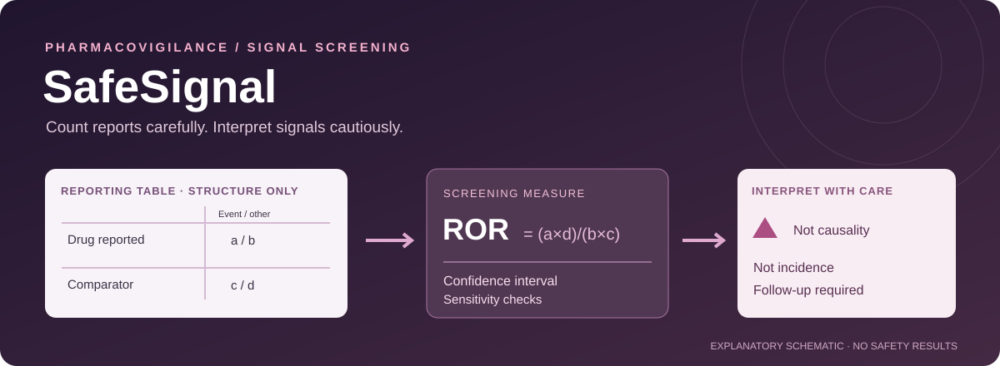
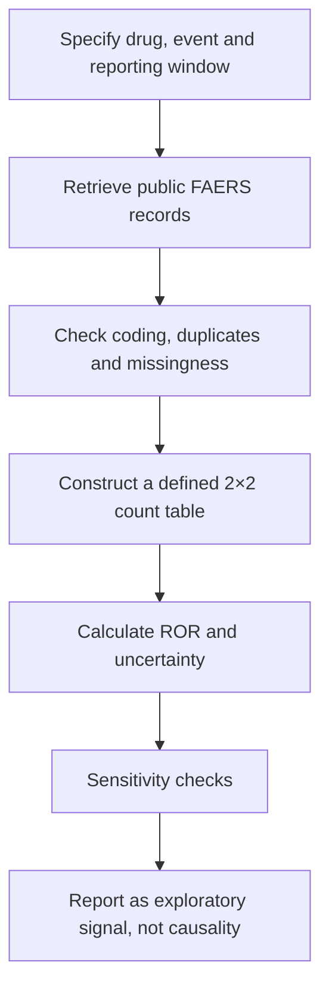

> **PHARMACOVIGILANCE / EVIDENCE DISCIPLINE**  
> **SafeSignal** investigates spontaneous adverse-event reporting patterns through auditable counts, disproportionality statistics, and careful interpretation.

[Read the safety boundary](#safety-boundary) · [Screening design](#screening-design) · [Statistics primer](#statistics-primer) · [Evidence checklist](#evidence-checklist)

> [!CAUTION]
> **Not a clinical decision tool.** Spontaneous reports are not proof of drug causality, and they do not provide valid incidence rates. No actual reports have been analyzed in this repository yet; the illustration above is conceptual.

## Safety boundary

The research question is deliberately narrow:

**For a predefined drug and event, is the combination reported disproportionately compared with a defined reference set—and does that pattern survive basic sensitivity checks?**

A detected signal would be a reason for **further evaluation**, not a conclusion that the medicine caused the event.

| This project can explore | This project cannot establish |
|---|---|
| Reporting patterns in selected FAERS data | Causal adverse drug reactions |
| Differences in drug–event reporting proportions | Absolute adverse-event risk |
| Sensitivity to comparison-set definitions | Treatment recommendations |
| Missingness and possible duplicates | Clinical safety of an individual patient |

## Screening design

## Statistics primer

The proposed first statistic is the **reporting odds ratio (ROR)**. It compares the odds of reporting a chosen event for reports involving a drug against reports involving a comparison group.

| | Event reported | Other events reported |
|---|---:|---:|
| Drug of interest | a | b |
| Comparison reports | c | d |

For positive cell counts, the elementary point estimate is **ROR = (a × d) / (b × c)**. Handling zero cells, uncertainty, duplicate reports, drug roles, and comparison-group definitions requires additional rules, which will be documented before calculating real results.

<strong>Why ROR is not an adverse-event probability</strong>

The denominator comes from **reported cases**, not a known population of treated individuals. Publicity, reporting practices, drug usage, missingness, and other biases influence what reaches the database. A large ROR can be interesting for screening, but does not independently identify causation or clinical risk.

## Evidence checklist

- [ ] Choose one narrowly defined drug class and event term.
- [ ] Review the [openFDA drug event API](https://open.fda.gov/apis/drug/event/) fields and FAIR-use constraints.
- [ ] Record acquisition time and search criteria.
- [ ] Inspect cases, report versions, duplicates, and naming inconsistencies.
- [ ] Define drug roles and the comparison group.
- [ ] Verify cell counts with simple independent checks.
- [ ] Calculate the ROR with a justified uncertainty method.
- [ ] Compare alternative inclusion and exclusion rules.
- [ ] Write a limitations-first, nonclinical interpretation.

## Planned analyst deliverables

1. **Data audit:** what was collected, missing, or excluded, with transparent counts.
2. **Statistical notebook:** explain the 2×2 table, computed quantities, and interpretation.
3. **Sensitivity analysis:** show whether conclusions depend strongly on reasonable coding decisions.
4. **Safety-communication brief:** what is worth investigating, what remains unknown, and why.

## Interview defense

> *“A drug–event pair has a high reporting odds ratio. Does that mean the drug is dangerous?”*

An appropriate answer distinguishes a reporting signal from risk and causality, checks the absolute counts and confidence interval, considers reporting biases, and proposes additional investigation instead of an unsupported clinical conclusion.

**Source:** [FDA openFDA Drug Adverse Events](https://open.fda.gov/apis/drug/event/). Reports and definitions require careful handling. Published conclusions will never be inferred from the conceptual diagram.

---

<strong>Related analytics projects and professional links</strong>

- [TrialScope](https://github.com/mbilal-OU/TrialScope) — trial benchmarking and prediction.
- [PharmaSpend](https://github.com/mbilal-OU/PharmaSpend) — spending analytics and SQL.
- [Research portfolio](https://mbilal-ou.github.io/portfolio/) — broader computational research profile.

