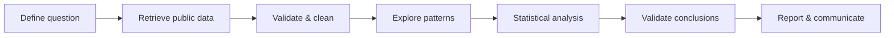

<div align="center">

# SafeSignal
### Pharmacovigilance · Adverse-event reporting analytics

**Real-world data · Reproducible analytics · Industry-focused learning**


[Why this project?](#why-this-project) · [Research questions](#research-questions) · [Learning roadmap](#learning-roadmap) · [Data](#data-source) · [Interview case](#interview-case)

</div>

> [!IMPORTANT]
> **Project stage: planning.** This repository defines a learning and analysis plan, not completed research. No dataset has been acquired or analyzed here yet. We will publish results only after running and verifying the code.

## Why this project?

SafeSignal explores publicly reported adverse events, data quality, and statistical disproportionality. It is designed as a learning and signal-screening analysis, **not** a clinical safety or causal-inference tool.

**Decision problem:** Which drug–event combinations appear disproportionately in spontaneous reports, and how robust are those patterns to data-quality choices?

## Research questions

1. How complete and consistent are the fields used to identify drugs and events?
2. What reporting patterns change across time and selected comparison groups?
3. How do reporting odds ratios behave in small versus large report counts?
4. How do inclusion rules and potential duplicate reports change conclusions?

## At a glance

| Dimension | Scope |
|:--|:--|
| Industry | Pharmacovigilance |
| Source | [openFDA — Drug Adverse Events API](https://open.fda.gov/apis/drug/event/) |
| Data type | Public, observational records |
| Analytical approach | Descriptive analysis first; statistical modeling only when justified |
| Key outcome | Transparent, reproducible findings—not a performance score alone |
| Current stage | **Planned — no reported results** |

## Analysis workflow



## Learning roadmap

- [ ] **01 · Understand reporting systems** — Learn what adverse-event reports represent—and do not represent
- [ ] **02 · Retrieve a bounded sample** — Query public API carefully and document the extraction date
- [ ] **03 · Audit report quality** — Inspect drug naming, event terms, missingness, and duplicates
- [ ] **04 · Count transparently** — Define drug–event 2×2 tables and comparison sets
- [ ] **05 · Learn statistics** — Calculate reporting odds ratios and confidence intervals
- [ ] **06 · Sensitivity checks** — Compare reasonable rules and identify unstable findings
- [ ] **07 · Communicate responsibly** — Write an exploratory safety surveillance brief

<details>
<summary><strong>📘 What I want to learn</strong> — expand</summary>

- REST APIs, JSON records, pagination and reproducible queries
- Categorical data, count tables, odds ratios, uncertainty
- Drug and event standardization and data-quality checks
- Selection bias, reporting bias, confounding and duplicates
- Sensitivity analysis and responsible safety communication
- No unsupported clinical or causal claims

**Learning rule:** Before adding a method, document what it measures, why it is appropriate, basic assumptions, Python implementation, actual output, and its limitations.

</details>

<details>
<summary><strong>🧪 Validation and reproducibility standards</strong> — expand</summary>

- Keep original source files immutable and document retrieval dates.
- Define the unit of observation, inclusion criteria, and outcome variables.
- Inspect missingness, duplicate records, inconsistent definitions, and potential selection bias.
- Establish a simple baseline before using more complex models.
- Separate training and validation information for any predictive analysis; avoid leakage.
- Record important methodological decisions **before** comparing candidate results.
- Publish reproducible instructions and dependency versions.
- Distinguish association, prediction, and causation.

</details>

## Data source

[openFDA — Drug Adverse Events API](https://open.fda.gov/apis/drug/event/)

We will document source URLs, access dates, field definitions, terms of use, and any cleaning rules before producing findings. **Do not commit private or sensitive data.**

## Proposed repository layout

```text
SafeSignal/
├── README.md
├── data/
│   └── README.md                 # provenance and download instructions
├── notebooks/                    # sequential, explainable analyses
├── sql/                          # SQL queries, where appropriate
├── figures/                      # verified exported results
├── results/                      # reproducible outputs
└── docs/
    ├── learning_log.md
    ├── project_decisions.md
    └── glossary.md
```

> This is a **target layout**, not a claim that these directories have already been created.

## Expected deliverables

- [ ] Public-data retrieval and audit notebook
- [ ] Documented, reproducible 2×2 counting logic
- [ ] Reporting odds ratios with uncertainty and interpretation
- [ ] Sensitivity analysis of selected drug–event pairs
- [ ] Nonclinical exploratory safety brief

## Interpretation guardrails

- An adverse-event report does not prove the drug caused an event.
- Spontaneous reporting data cannot estimate incidence or absolute risk without appropriate denominators.
- Report counts are influenced by publicity, reporting practices, and duplicate submissions.
- Disproportionality is a screening signal, not a validated causal association or clinical recommendation.

## Interview case

> **Question a stakeholder might ask:** Does an elevated reporting odds ratio mean this medicine causes the adverse event?

**What this portfolio should demonstrate:** The ability to calculate a statistical screening measure, identify reporting biases and denominator problems, and explain why additional clinical investigation is needed.

<details>
<summary><strong>🎤 Interview preparation checklist</strong> — expand</summary>

- [ ] Explain the business or research decision in one minute.
- [ ] Explain data sources, inclusion criteria, and dataset limitations.
- [ ] Walk through the SQL / Python transformations independently.
- [ ] Explain why the statistical method or model is appropriate.
- [ ] Present verified numerical findings (never placeholders).
- [ ] Describe an alternative explanation and an important limitation.
- [ ] Explain what a stakeholder could reasonably do next.

</details>

---

<div align="center">

**Part of an industry Data Science learning series**

[TrialScope](https://github.com/mbilal-OU/TrialScope) · [PharmaSpend](https://github.com/mbilal-OU/PharmaSpend) · [SafeSignal](https://github.com/mbilal-OU/SafeSignal)

[Research portfolio](https://mbilal-ou.github.io/portfolio/) · [GitHub profile](https://github.com/mbilal-OU)

<sub>Maintained as a transparent learning and research portfolio. Claims and results will be added only after independent verification.</sub>

</div>
